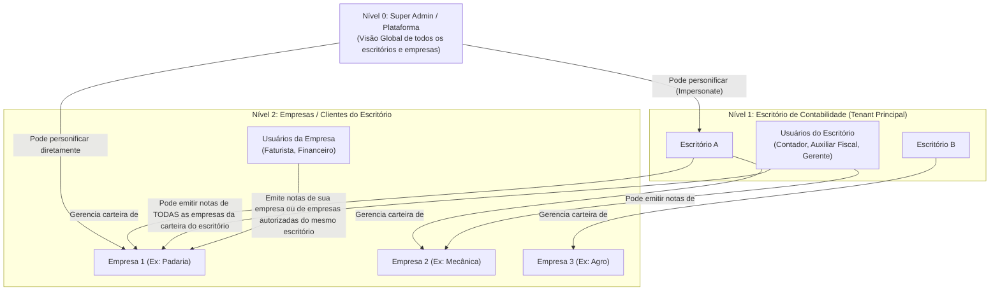

# Regras Canônicas de Multi-Tenancy e Hierarquia de Acesso (3 Níveis + Personificação)

## 1. Níveis de Hierarquia do Sistema

---

## 2. Matriz de Papéis e Permissões de Emissão

| Ator | Escopo de Visualização | Capacidade de Emissão | Personificação (Impersonate) |
|---|---|---|---|
| **Super Admin** | Todos os escritórios, empresas e notas de toda a plataforma | Qualquer empresa de qualquer escritório | Pode personificar qualquer Escritório ou Empresa diretamente |
| **Usuário do Escritório** (`Office User`) | Todas as empresas clientes vinculadas ao seu `office_id` | Pode emitir NFS-e em nome de **qualquer empresa cliente** do seu escritório | Pode personificar qualquer empresa da sua própria carteira |
| **Usuário da Empresa** (`Company User`) | Restrito à(s) empresa(s) para a(s) qual(is) recebeu acesso explícito | Emite em nome da sua empresa (ou empresas autorizadas do mesmo escritório) | Não personifica |

---

## 3. Regras de Personificação (Impersonation)
- **Token / Sessão com Duplo Contexto:**
  - `auth_user_id`: O usuário real logado (para trilha de auditoria e logs de conformidade).
  - `impersonated_office_id`: Escritório que está sendo personificado no momento.
  - `impersonated_company_id`: Empresa cliente que está ativa no momento da emissão.
- **Trilha de Auditoria Inviolável:**
  - Toda emissão de NFS-e grava na tabela `invoices`:
    - `created_by_user_id` (o usuário real, mesmo personificando).
    - `acting_role` (`SUPER_ADMIN`, `OFFICE_USER`, `COMPANY_USER`).
    - `impersonated_from` (se houve personificação, registra a origem para fins legais perante a Receita e o cliente).
- **Banner de Segurança na Interface:** Quando o Super Admin ou o Escritório estiver personificando uma empresa, a UI exibe um banner fixo de aviso com botão de "Sair da Personificação".

---

## 4. Como o `TenantScope` Eloquent Funciona com essa Hierarquia

O `TenantScope` não pode ser um filtro cego de `office_id`. Ele opera com resolução dinâmica:

1. **Se for Super Admin:**
   - **Sem personificação:** O escopo é desativado (`TenantScope` bypass) permitindo visão global e dashboards executivos.
   - **Com personificação ativa:** Aplica o `office_id` ou `company_id` alvo da personificação.
2. **Se for Usuário do Escritório:**
   - O escopo restringe obrigatoriamente a `office_id = auth_office_id`.
   - O usuário pode selecionar qualquer `company_id` pertencente àquele `office_id` para emitir notas em lote ou avulsas.
3. **Se for Usuário da Empresa:**
   - O escopo restringe a `company_id IN (empresas_autorizadas_do_usuario)`.
