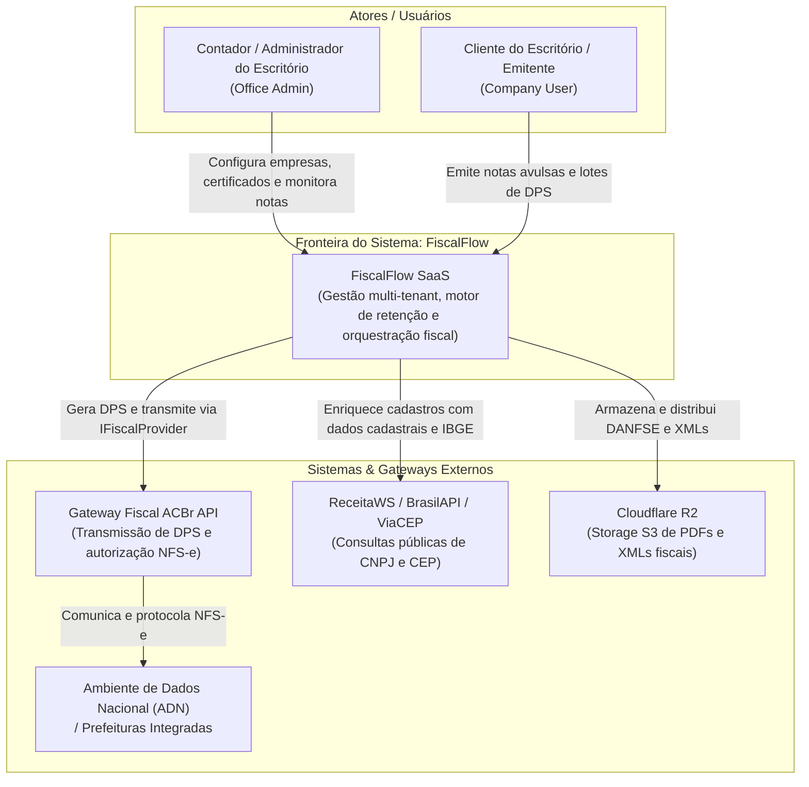
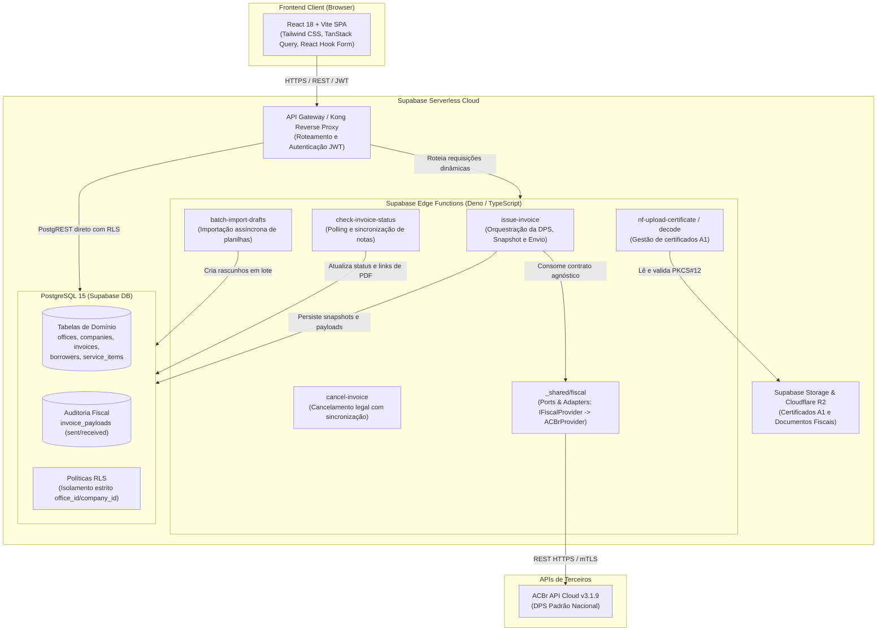

# Arquitetura — FiscalFlow (AS-IS)

> Documento gerado em conformidade com o framework Reversa para suporte à migração para Laravel.  
> Modelo C4 (Contexto C4-L1 e Containers C4-L2).

---

## 1. Diagrama C4 — Nível 1: Contexto de Sistema

Mostra os atores humanos, o FiscalFlow e os sistemas e órgãos externos com os quais interage.

---

## 2. Diagrama C4 — Nível 2: Containers de Software

Visão detalhada da topologia atual em execução (React SPA + Supabase Serverless + PostgreSQL).

---

## 3. Principais Módulos do Sistema e suas Responsabilidades

1. **Camada de Apresentação (React):** Gerencia fluxos de emissão rápida, wizards de onboarding via certificado, dashboards com KPIs e listagens com paginação.
2. **Motor de Regras Tributárias (Frontend & Functions):**
   - `taxEngine.ts`: Realiza os cálculos preliminares em memória para feedback imediato na UI.
   - `retentionLogic.ts`: Avalia a hierarquia de 5 níveis de retenção de ISS.
3. **Módulo Fiscal Hexagonal (`_shared/fiscal`):**
   - Porta agnóstica (`IFiscalProvider`): Define 11 operações padrão (emissão, consulta, cancelamento, certificado, etc.).
   - Adaptador concreto (`ACBrProvider`): Traduz o modelo de domínio do FiscalFlow para o schema estrito da ACBr API v3.1.9.
4. **Camada de Persistência (PostgreSQL + RLS):**
   - Garante segregação multi-tenant por meio de `auth.uid()` associado ao `office_id`.
   - Utiliza campos `JSONB` (`borrower_snapshot`, `iss_snapshot`) para congelar o estado fiscal no momento da emissão.
