# ERD Completo — FiscalFlow

> Gerado pelo agente Data Master / Archaeologist em 2026-11-05.  
> Fonte: migrações SQL consolidadas (`20251213220714_remote_schema.sql` + patches subsequentes).

---

## Diagrama Relacional (Mermaid ERD)

```mermaid
erDiagram

    %% =========================================================
    %% MULTI-TENANT CORE
    %% =========================================================

    offices {
        uuid    id PK "DEFAULT uuid_generate_v4()"
        text    name
        text    cnpj
        text    status "ACTIVE | SUSPENDED"
        text    plan   "STARTER | GROWTH | ENTERPRISE"
        jsonb   subscription "{ planId, status, cycleStart, nextBillingDate, currentUsage }"
        timestamptz created_at "DEFAULT now()"
    }

    subscription_plans {
        uuid    id PK
        text    name
        text    description
        numeric base_price
        integer monthly_quota
        numeric overage_price
        jsonb   features
        text    color
    }

    profiles {
        uuid    id PK "FK → auth.users.id"
        uuid    office_id FK "→ offices.id"
        uuid    company_id FK "→ companies.id (opcional)"
        text    name
        text    email
        text    role "PLATFORM_ADMIN | OFFICE_ADMIN | CLIENT_ADMIN | USER"
        text    avatar_url
        timestamptz created_at
    }

    office_invites {
        uuid    id PK
        uuid    office_id FK "→ offices.id"
        text    email
        text    name
        text    role
        text    status "PENDING | ACCEPTED | EXPIRED"
        timestamptz created_at
        timestamptz expires_at
    }

    companies {
        uuid    id PK "DEFAULT uuid_generate_v4()"
        uuid    office_id FK "→ offices.id NOT NULL"
        text    name  "NOT NULL"
        text    trade_name
        text    cnpj  "NOT NULL"
        text    status "ACTIVE | PENDING | SUSPENDED — DEFAULT 'PENDING'"
        text    email
        text    phone
        text    municipal_registration
        text    tax_regime "SIMPLES_NACIONAL | LUCRO_PRESUMIDO | LUCRO_REAL"
        text    environment "homologacao | producao"
        boolean tax_incentive "DEFAULT false"
        numeric iss_rate "DEFAULT 0"
        jsonb   address "{ cep, street, number, neighborhood, city, state, ibgeCode, complement }"
        jsonb   certificate "{ hasCertificate, expirationDate, thumbprint, subject }"
        jsonb   reg_trib "{ opSimpNac:1|2|3, regEspTrib:0-6, regApTribSN:1|2|3|null }"
        jsonb   rps "{ lote, serie, numero }"
        jsonb   city_hall "{ login, senha, token }"
        jsonb   settings "{ homologacao: { status, nuvemFiscalId, rps }, producao: {...} }"
        text    logo_url
        boolean has_logo
        text    fiscal_provider "DEFAULT 'acbr'"
        text    provider_company_id
        text    acbr_company_id
        text    nuvem_fiscal_company_id "LEGADO"
        timestamptz created_at "DEFAULT now()"
    }

    %% =========================================================
    %% FISCAL — TOMADORES
    %% =========================================================

    borrowers {
        uuid    id PK "DEFAULT uuid_generate_v4()"
        uuid    company_id FK "→ companies.id NOT NULL"
        text    tax_id "CPF (11) ou CNPJ (14) NOT NULL"
        text    name  "NOT NULL"
        text    email
        text    phone
        text    municipal_registration
        jsonb   address "{ cep, street, number, complement, neighborhood, city, state, ibgeCode }"
        boolean iss_withheld "DEFAULT false — Retém ISS"
        timestamptz created_at "DEFAULT now()"
    }

    %% =========================================================
    %% FISCAL — CATÁLOGO DE SERVIÇOS
    %% =========================================================

    service_types {
        uuid    id PK
        text    ctribnac "6 dígitos — cTribNac nacional"
        text    description
        boolean is_due_at_execution
        boolean allows_deduction
        text    default_nbs
        boolean mandatory_retention_suggestion
    }

    tax_taxonomy_master {
        uuid    id PK
        uuid    parent_id FK "→ tax_taxonomy_master.id (self-ref)"
        text    code "Agrupador LC116 (ex: 1.05)"
        text    nbs  "Código NBS (ex: 1.05.01.00)"
        text    description
        integer hierarchy_level
        boolean is_leaf
    }

    service_items {
        uuid    id PK "DEFAULT uuid_generate_v4()"
        uuid    company_id FK "→ companies.id NOT NULL"
        uuid    service_type_id FK "→ service_types.id"
        uuid    taxonomy_id FK "→ tax_taxonomy_master.id (opcional)"
        text    description  "NOT NULL"
        numeric unit_price
        numeric iss_aliquot "Alíquota ISS — ex: 2.00, 5.00"
        text    municipal_tax_code "cTribMun — max 5 chars"
        text    nbs "Código NBS (desnormalizado / override)"
        boolean allow_retention "Master switch de retenção"
        boolean sn_retention_subject "Retenção para Simples Nacional"
        boolean general_regime_retention_subject "Retenção para Lucro Real/Presumido"
        timestamptz created_at "DEFAULT now()"
    }

    %% =========================================================
    %% FISCAL — NOTAS FISCAIS
    %% =========================================================

    invoices {
        uuid    id PK "DEFAULT uuid_generate_v4()"
        uuid    company_id FK "→ companies.id NOT NULL"
        uuid    batch_id FK "→ invoice_batches.id (opcional)"
        integer number "Número da NFS-e"
        text    borrower_name "NOT NULL"
        text    borrower_cnpj "NOT NULL (CPF ou CNPJ)"
        numeric amount "NOT NULL — valor bruto"
        numeric discount_amount "DEFAULT 0 — desconto incondicionado"
        numeric iss_aliquot "DEFAULT 0"
        numeric iss_amount "DEFAULT 0"
        boolean iss_withheld "DEFAULT false"
        text    service_code "cTribNac do serviço"
        text    description
        text    status "DRAFT|CREATED|PROCESSING|AUTHORIZED|ERROR|CANCELED|CANCELING|DENIED"
        text    environment "homologacao | producao"
        text    fiscal_provider "ex: 'acbr'"
        text    provider_invoice_id "ID no provedor fiscal"
        text    acbr_id "ID específico ACBr"
        text    nuvem_fiscal_id "LEGADO"
        text    verification_code "Código de verificação NFS-e"
        text    access_key "Chave de acesso"
        text    pdf_url
        text    xml_url
        text    cancel_xml_url
        text    cancel_pdf_url
        jsonb   cancellation_data "{ id, codigo, motivo, data_hora }"
        jsonb   iss_snapshot "Snapshot imutável do cálculo fiscal no momento da emissão"
        jsonb   borrower_snapshot "Snapshot imutável dos dados do tomador"
        jsonb   logs "Array de InvoiceLog: [ { timestamp, level, message, details } ]"
        timestamptz issued_at "DEFAULT now()"
        timestamptz competence_date "Data de competência fiscal"
        timestamptz updated_at "DEFAULT now()"
    }

    invoice_batches {
        uuid    id PK "DEFAULT uuid_generate_v4()"
        uuid    company_id FK "→ companies.id NOT NULL"
        text    name
        text    status "OPEN | PROCESSING | COMPLETED | ARCHIVED"
        integer total_records "DEFAULT 0"
        integer processed_count "DEFAULT 0"
        integer error_count "DEFAULT 0"
        timestamptz created_at "DEFAULT now()"
    }

    invoice_payloads {
        uuid    id PK
        uuid    invoice_id FK "→ invoices.id"
        text    direction "'sent' | 'received'"
        jsonb   payload "Raw payload enviado/recebido ao provedor"
        timestamptz created_at "DEFAULT now()"
    }

    %% =========================================================
    %% GEO — MUNICÍPIOS
    %% =========================================================

    municipalities {
        uuid    id PK
        text    ibge_code "NOT NULL UNIQUE"
        text    name
        text    uf
        boolean uses_portal_nacional
        boolean suppress_municipal_tax_code
        jsonb   iss_default_aliquots "[ { serviceCode, aliquot } ]"
        text    nfs_rules "Regras específicas em JSON/texto"
    }

    %% =========================================================
    %% ANALYTICS
    %% =========================================================

    platform_analytics {
        uuid    id PK
        text    event_type
        jsonb   payload
        timestamptz created_at
    }

    %% =========================================================
    %% RELACIONAMENTOS
    %% =========================================================

    offices            ||--o{ companies            : "possui"
    offices            ||--o{ profiles             : "tem"
    offices            ||--o{ office_invites       : "emite"

    companies          ||--o{ profiles             : "tem (CLIENT_ADMIN/USER)"
    companies          ||--o{ borrowers            : "cadastra"
    companies          ||--o{ service_items        : "configura"
    companies          ||--o{ invoices             : "emite"
    companies          ||--o{ invoice_batches      : "importa"

    service_items      }o--|| service_types        : "baseia-se em"
    service_items      }o--o| tax_taxonomy_master  : "classifica com NBS"
    tax_taxonomy_master||--o{ tax_taxonomy_master  : "hierarquia (self-ref)"

    invoices           }o--|| companies            : "pertence a"
    invoices           }o--o| invoice_batches      : "parte de lote"
    invoices           ||--o{ invoice_payloads     : "tem payloads"

    profiles           }o--|| offices              : "pertence ao escritório"
    profiles           }o--o| companies            : "vinculado a empresa"
    office_invites     }o--|| offices              : "do escritório"
```



---

## Enums e Domínios de Valores

### `invoice_status` (constraint + enum)
| Valor | Descrição |
|-------|-----------|
| `DRAFT` | Rascunho criado pelo usuário ou importado em lote |
| `CREATED` | Enviado para processamento (intermediário) |
| `PROCESSING` | Aguardando resposta da prefeitura/SEFAZ |
| `AUTHORIZED` | Nota autorizada com sucesso |
| `ERROR` | Falha na emissão — detalhe em `logs` |
| `DENIED` | Negada pela prefeitura — com motivo em `logs` |
| `CANCELING` | Cancelamento em andamento (irreversível) |
| `CANCELED` | Cancelada com XML/PDF de cancelamento |

### `user_role`
| Valor | Escopo |
|-------|--------|
| `PLATFORM_ADMIN` | Acesso total à plataforma |
| `OFFICE_ADMIN` | Gerencia escritório e todas as suas empresas |
| `CLIENT_ADMIN` | Gerencia apenas uma empresa específica |
| `USER` | Acesso somente leitura / operacional |

### `reg_trib.opSimpNac`
| Valor | Regime |
|-------|--------|
| `1` | Regime Geral (Lucro Real / Lucro Presumido) |
| `2` | MEI (Microempreendedor Individual) |
| `3` | ME/EPP optante pelo Simples Nacional |

### `reg_trib.regEspTrib`
| Valor | Regime Especial |
|-------|----------------|
| `0` | Nenhum |
| `1` | Cooperativa |
| `2` | Estimativa |
| `3` | Microempresa Municipal |
| `4` | Notário/Registrador |
| `5` | Profissional Autônomo |
| `6` | Sociedade de Profissionais |

---

## Índices Relevantes

| Tabela | Coluna | Tipo |
|--------|--------|------|
| `invoices` | `provider_invoice_id` | BTREE (parcial: NOT NULL) |
| `companies` | `provider_company_id` | BTREE |
| `borrowers` | `company_id, tax_id` | (implícito por constraint UNIQUE) |
| `tax_taxonomy_master` | `parent_id` | (FK index) |

---

## Triggers e Funções PostgreSQL

### `handle_new_user()` — TRIGGER após INSERT em `auth.users`
Cria automaticamente um registro em `profiles` com role `USER`.

```sql
CREATE TRIGGER on_auth_user_created
  AFTER INSERT ON auth.users
  FOR EACH ROW EXECUTE FUNCTION handle_new_user();
```

### `prevent_authorized_deletion()` — TRIGGER BEFORE DELETE em `invoices`
Bloqueia exclusão física de notas com status `AUTHORIZED`, `PROCESSING` ou `CANCELED`.

```sql
CREATE TRIGGER prevent_authorized_invoice_deletion
  BEFORE DELETE ON invoices
  FOR EACH ROW EXECUTE FUNCTION prevent_authorized_deletion();
```

### `auto_map_legacy_items()` — FUNCTION
Mapeia service_types legados para itens da empresa via `cTribNac`.

### `get_my_claims()` — FUNCTION (RLS)
Retorna claims do JWT do usuário autenticado para uso nas políticas RLS:
- `role` → papel do usuário
- `office_id` → escritório
- `company_id` → empresa (CLIENT_ADMIN/USER)

### `rebuild_taxonomy_tree()` / `search_taxonomy()` — FUNCTIONS
Reconstrução e busca hierárquica na tabela `tax_taxonomy_master`.

---

## Políticas RLS (Row Level Security)

Todas as tabelas têm RLS habilitado. O padrão geral é:

| Papel | Regra de acesso |
|-------|----------------|
| `PLATFORM_ADMIN` | Acesso irrestrito a tudo |
| `OFFICE_ADMIN` | `office_id = get_my_claims()->>'office_id'` |
| `CLIENT_ADMIN` | `company_id = get_my_claims()->>'company_id'` |
| `USER` | Idem `CLIENT_ADMIN`, somente leitura em alguns recursos |

Escritas (`INSERT`, `UPDATE`, `DELETE`) geralmente requerem `OFFICE_ADMIN` ou superior.
