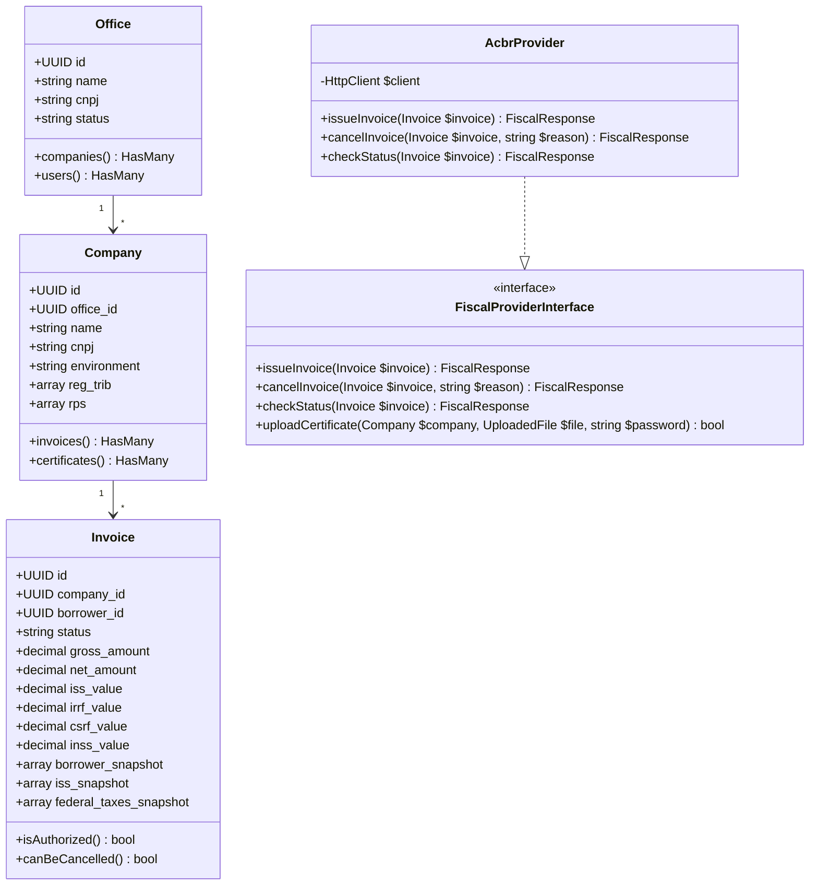

# Arquitetura Alvo & Especificação de Porte para Laravel (FiscalFlow)

> Documento gerado pelo **Designer** do Time de Migração Reversa em 2026-11-05.  
> Transforma a análise de código, domínio e auditoria em um blueprint de engenharia pronto para implementação em Laravel.

---

## 1. Decisão de Stack & Paradigma

```
Paradigma Escolhido: Laravel 11 + Modular Monolith + Inertia.js (React 18)
```

### Justificativa da Escolha:
- **Preservação de Componentes:** Permite reaproveitar praticamente todos os componentes visuais em React (telas de emissão, modais, wizards de onboarding e tabelas com Tailwind) sem precisar reescrever em Blade.
- **Eliminação de Código Duplicado:** O cálculo fiscal passa a existir **exclusivamente no backend PHP**, eliminando o drift entre frontend e backend (LOGIC-006).
- **Substituição de Edge Functions:** As 18 Edge Functions em Deno são substituídas nativamente por **Controllers, Form Requests e Laravel Jobs com Redis Queues**.

---

## 2. Mapa de Decomposição: Supabase/Deno → Laravel

| Componente Atual (AS-IS) | Equivalente Laravel 11 (TO-BE) | Padrão / Recurso Utilizado |
|:---|:---|:---|
| `supabase/functions/issue-invoice` | `App\Http\Controllers\InvoiceIssuanceController` + `IssueInvoiceJob` | Action/Job com Queue no Redis |
| `supabase/functions/batch-import-drafts` | `App\Jobs\ProcessInvoiceBatchJob` | Laravel Job Batching (`Bus::batch()`) |
| `supabase/functions/cancel-invoice` | `App\Http\Controllers\InvoiceCancellationController` | Service Layer com transação DB |
| `supabase/functions/check-invoice-status` | `App\Jobs\CheckInvoiceStatusJob` | Delayed Queue com Backoff Exponencial |
| `supabase/functions/nf-upload-certificate` | `App\Services\CertificateService` | Validação PKCS#12 via extensão PHP OpenSSL |
| `_shared/fiscal/interfaces/IFiscalProvider.ts` | `App\Contracts\Fiscal\FiscalProviderInterface.php` | Interface nativa PHP 8.3 (Ports & Adapters) |
| `_shared/fiscal/providers/acbr/` | `App\Services\Fiscal\Providers\AcbrProvider.php` | Adaptador concreto consumindo ACBr API |
| `_shared/fiscal/fiscalProviderFactory.ts` | `App\Services\Fiscal\FiscalProviderFactory.php` | Factory Pattern com injeção de dependência |
| `src/services/issuance/taxEngine.ts` | `App\Services\Fiscal\TaxEngineService.php` | Domain Service puro com cálculo de ISS e Federais |
| `src/services/retentionLogic.ts` | `App\Services\Fiscal\RetentionResolver.php` | Chain of Responsibility para os 5 níveis |
| Políticas RLS do Postgres | `App\Models\Scopes\TenantScope.php` + Policies | Eloquent Global Scope + Authorization Policies |
| Supabase Auth (GoTrue) | Laravel Breeze / Fortify / Sanctum | Autenticação padrão de sessão e API Tokens |

---

## 3. Modelo de Domínio Alvo (Estrutura de Classes Laravel)



---

## 4. Implementação do Motor Fiscal com Retenções Federais (Resolução de LOGIC-001 e ADR 005)

No Laravel, o motor fiscal passa a implementar nativamente a **ADR 005** e as retenções federais:

```php
namespace App\Services\Fiscal;

use App\Models\Company;
use App\Models\Borrower;
use App\Models\ServiceItem;

class TaxEngineService
{
    private const PISO_DISPENSA_RETENCAO_FEDERAL = 10.00; // ADR 005

    public function calculate(
        float $quantity,
        float $unitPrice,
        float $discount,
        float $issRate,
        ServiceItem $service,
        Company $provider,
        Borrower $borrower
    ): TaxCalculationResult {
        $grossAmount = max(0, $quantity * $unitPrice);
        $baseCalculation = max(0, $grossAmount - $discount);

        // 1. Cálculo de ISS (com guard de 5%)
        $validatedIssRate = min(5.00, max(0.00, $issRate));
        $retentionResult = app(RetentionResolver::class)->resolve($provider, $borrower, $service);
        $issValue = round(($baseCalculation * $validatedIssRate) / 100, 2);

        // 2. Cálculo de Retenções Federais (ADR 005 - Piso R$ 10 por Fato Gerador)
        $irrfValue = 0.00;
        $inssValue = 0.00;
        $csrfValue = 0.00;

        if ($this->shouldCalculateFederalTaxes($provider, $borrower)) {
            // IRRF (alíquota padrão de 1,5% para serviços profissionais)
            $rawIrrf = round(($baseCalculation * ($service->irrf_rate ?? 1.50)) / 100, 2);
            $irrfValue = ($rawIrrf > self::PISO_DISPENSA_RETENCAO_FEDERAL) ? $rawIrrf : 0.00;

            // CSRF (PIS/COFINS/CSLL - 4,65% conjunto)
            $rawCsrf = round(($baseCalculation * 4.65) / 100, 2);
            $csrfValue = ($rawCsrf > self::PISO_DISPENSA_RETENCAO_FEDERAL) ? $rawCsrf : 0.00;

            // INSS (Previdência - 11% com teto)
            if ($service->inss_retention_required) {
                $rawInss = round(($baseCalculation * 11.00) / 100, 2);
                $inssValue = min($rawInss, config('fiscal.inss_teto_maximo'));
            }
        }

        // 3. Valor Líquido (Base subtraída de todos os tributos retidos)
        $totalRetencoes = ($retentionResult->mustRetain ? $issValue : 0.00)
            + $irrfValue
            + $csrfValue
            + $inssValue;

        $netAmount = max(0.00, $baseCalculation - $totalRetencoes);

        return new TaxCalculationResult(
            grossAmount: $grossAmount,
            baseCalculation: $baseCalculation,
            issRate: $validatedIssRate,
            issValue: $issValue,
            isIssRetained: $retentionResult->mustRetain,
            irrfValue: $irrfValue,
            csrfValue: $csrfValue,
            inssValue: $inssValue,
            netAmount: $netAmount
        );
    }

    private function shouldCalculateFederalTaxes(Company $provider, Borrower $borrower): bool
    {
        // MEI e Simples Nacional não sofrem retenção federal na fonte
        if ($provider->isSimplesNacional() || $provider->isMei()) {
            return false;
        }

        // Tomador pessoa física não retém impostos federais
        if ($borrower->isPessoaFisica()) {
            return false;
        }

        return true;
    }
}
```

---

## 5. Estratégia de Migração de Dados (Supabase → Laravel)

1. **Schema & Migrations:**
   - Criar migrations Laravel a partir de `_reversa_sdd/erd-complete.md`.
   - Adicionar colunas explícitas para tributos federais (`irrf_value`, `csrf_value`, `inss_value`) que antes ficavam espalhadas em JSON.
2. **Importação Histórica (ETL via Command):**
   - Criar um comando `php artisan fiscalflow:import-legacy-supabase`:
     - Lê via PDO do banco Postgres antigo.
     - Insere em lotes nos novos modelos Eloquent.
     - Converte os snapshots JSONB para campos compatíveis.
3. **Validação de Paridade:**
   - Executar os testes Gherkin de paridade para assegurar que para os mesmos inputs tributários, o Laravel gera payloads idênticos aos exigidos pela ACBr API v3.1.9.
